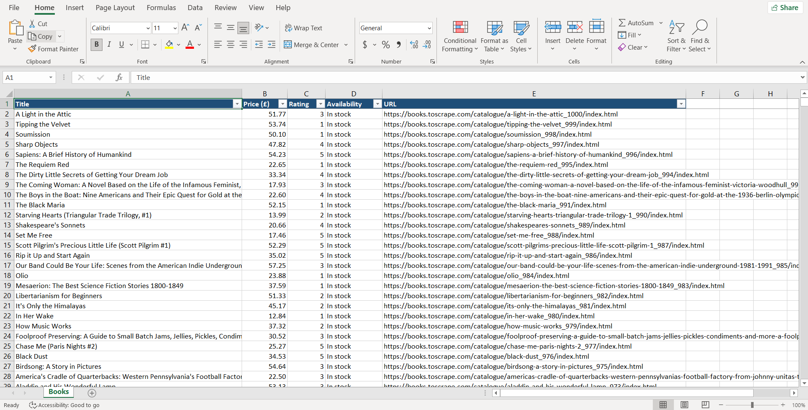

# Books Scraper — 1,000 Books to Excel

A Python web scraper that collects data on all 1,000 books from
[books.toscrape.com](https://books.toscrape.com) (50 pages) and exports it
to a clean, formatted Excel file.

## What it collects

| Field        | Example                                   |
|--------------|-------------------------------------------|
| Title        | A Light in the Attic                      |
| Price (£)    | 51.77                                     |
| Rating (1–5) | 3                                         |
| Availability | In stock                                  |
| URL          | https://books.toscrape.com/catalogue/...  |

## Features

- Crawls all 50 catalogue pages automatically
- Converts prices to numbers and star ratings to a 1–5 scale
- Polite scraping with a delay between requests
- Formatted Excel output: styled header, filters, frozen top row

## Tech stack

Python · Requests · BeautifulSoup · pandas · openpyxl

## How to run

pip install -r requirements.txt
python books_all.py

The result is saved as `books.xlsx` next to the script.

## Sample output

## Need data from another website?

I build custom scrapers that deliver clean, ready-to-use data in Excel or CSV.
Feel free to reach out on Fiverr.